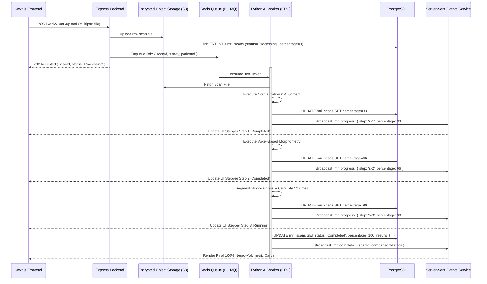
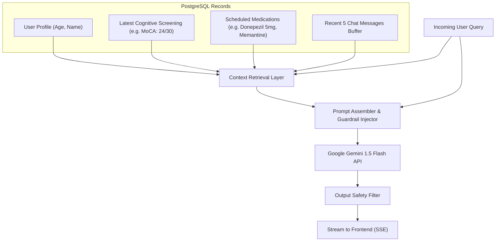
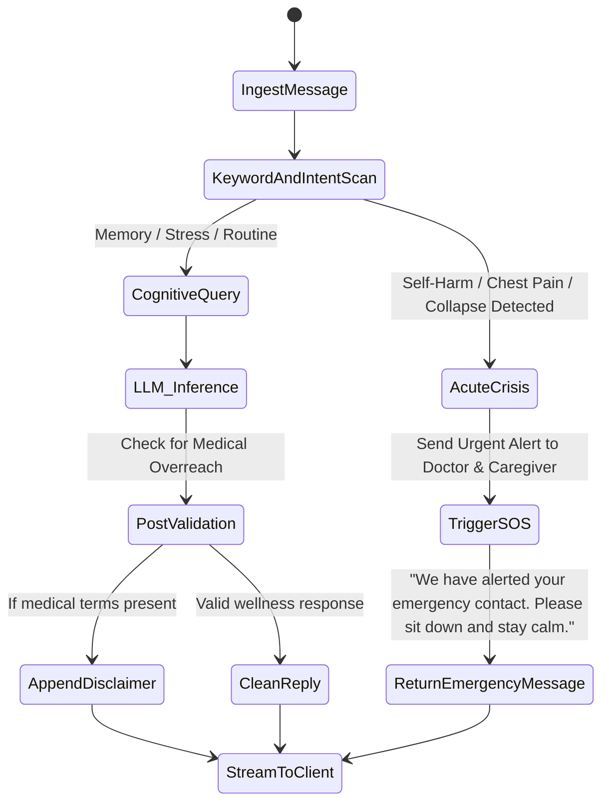

# 🧠 Cogni Care — Complete AI Models & Pipeline Technical Documentation

**Document Title:** Cogni Care Artificial Intelligence Architecture & Workflow Specification  
**Version:** 1.0  
**Target Systems:** Medical Neuroimaging Pipeline (MRI/CT) & Conversational Wellness Agent  
**Language:** TypeScript (Node.js/Express) + Python (PyTorch/MONAI) + Google Gemini API  

2
## 📑 Table of Contents

1. [Executive Summary](#1-executive-summary)
2. [AI Architecture Overview](#2-ai-architecture-overview)
3. [MRI & CT Neuroimaging AI Pipeline](#3-mri--ct-neuroimaging-ai-pipeline)
   - 3.1 Pipeline Stages & Mathematical Modeling
   - 3.2 Asynchronous Worker & Queue Architecture
   - 3.3 Multimodal Clinical Synthesis with Gemini Vision
   - 3.4 Data Contracts & Frontend Type Compatibility
4. [Conversational AI Wellness Assistant Pipeline](#4-conversational-ai-wellness-assistant-pipeline)
   - 4.1 Context Retrieval Engine (RAG)
   - 4.2 System Prompt & Cognitive Grounding
   - 4.3 Safety, Guardrails & Emergency SOS Escalation
   - 4.4 Real-Time Streaming Architecture
5. [Complete API Contracts for AI Modules](#5-complete-api-contracts-for-ai-modules)
6. [Database Schema for AI Persistence](#6-database-schema-for-ai-persistence)
7. [Implementation Code Blueprints](#7-implementation-code-blueprints)
   - 7.1 Python Worker: Neuroimaging Segmentation Mock/Pipeline
   - 7.2 Express.js: AI Assistant Service with Streaming
8. [Regulatory, Safety & Medical Compliance](#8-regulatory-safety--medical-compliance)

## 1. Executive Summary

Cogni Care integrates two distinct Artificial Intelligence subsystems to address cognitive health monitoring:

1. **Medical Computer Vision & Volumetric Pipeline:** An asynchronous, deep-learning pipeline designed to ingest 3D neuroimaging files (MRI in `.dcm`, `.nii` and CT scans), perform voxel-based segmentation of critical brain structures (Hippocampus, Ventricles, Cortical Mantle), and synthesize longitudinal structural changes into actionable metrics.
2. **Clinical Wellness Conversational Agent:** A retrieval-augmented conversational AI powered by Google Gemini 1.5 Flash that personalizes advice based on the patient's age, daily medication adherence, and recent cognitive screening (MoCA/MMSE) scores while strictly enforcing medical disclaimers and crisis SOS protocols.

---

## 2. AI Architecture Overview

```mermaid
flowchart LR
    subgraph INGESTION["Input Sources"]
        IMG["3D MRI / CT Scans (.dcm, .nii)"]
        PROMPT["Patient Chat & Wellness Queries"]
    end

    subgraph WORKERS["AI Processing Cores"]
        subgraph VISION_CORE["Neuro-Vision Core"]
            MONAI["MONAI / FastSurfer 3D-UNet Segmentation"]
            GEMINI_VIS["Gemini 1.5 Pro Multimodal Vision"]
        end
        subgraph LLM_CORE["Conversational Core"]
            RAG["Context Enrichment Engine"]
            GEMINI_LLM["Gemini 1.5 Flash with Health Guardrails"]
        end
    end

    subgraph OUTPUTS["Consumer Endpoints"]
        PATIENT_UI["Patient Portal (Cards & Live Chat)"]
        DOCTOR_UI["Doctor Attention Queue & Clinical Notes"]
        CAREGIVER_UI["Caregiver Alerts & SOS Dispatch"]
    end

    IMG --> MONAI --> GEMINI_VIS --> DOCTOR_UI & PATIENT_UI
    PROMPT --> RAG --> GEMINI_LLM --> PATIENT_UI
    GEMINI_LLM -.->|Crisis Detected| CAREGIVER_UI & DOCTOR_UI
---
## 3. MRI & CT Neuroimaging AI Pipeline

### 3.1 Pipeline Stages & Mathematical Modeling

Medical neuroimaging requires high spatial precision. The processing pipeline runs through 7 discrete stages:

```
[Raw DICOM/NIfTI] 
       ↓ (Stage 1: Ingestion & De-Identification)
[PII-Stripped Voxel Volume] 
       ↓ (Stage 2: Intensity Normalization & Skull-Stripping)
[Brain Parenchyma Mask] 
       ↓ (Stage 3: Spatial Affine Registration to MNI152 Space)
[Standardized Volume] 
       ↓ (Stage 4: Deep Voxel Segmentation - MONAI 3D-UNet)
[Segmented Structures (Hippocampus, Ventricles, Cortex)] 
       ↓ (Stage 5: Quantitative Metric Extraction)
[Volumetric Vector & Longitudinal Delta (% change)] 
       ↓ (Stage 6: Gemini 1.5 Pro Multimodal Synthesis)
[Structured JSON Output + Physician Remarks]

#### Key Volumetric Metrics:

1. **Hippocampal Volume ($V_{\text{hipp}}$):**
   $$V_{\text{hipp}} = \sum_{v \in \Omega_{\text{hipp}}} \text{VoxelSize}_x \times \text{VoxelSize}_y \times \text{VoxelSize}_z$$
   *Clinical Significance:* Early biomarker for Alzheimer's Disease and Amnestic Mild Cognitive Impairment (aMCI). Typical adult volume is $\approx 3.5 - 4.2 \text{ cm}^3$. Significant shrinkage ($>1.5\%$ per year) flags clinical attention.

2. **Ventricular Enlargement Ratio (Ventricle-to-Brain Ratio - VBR):**
   $$\text{VBR} = \frac{V_{\text{lateral\_ventricles}}}{V_{\text{total\_intracranial\_volume}}} \times 100\%$$
   *Clinical Significance:* Ventricular expansion correlates with ex-vacuo brain tissue atrophy.

3. **Mean Cortical Thickness ($T_{\text{cortex}}$):**
   Measures Euclidean distance between the gray-white boundary and the pial surface across neocortical vertices. Normal range: $2.2 - 2.8 \text{ mm}$.

---

### 3.2 Asynchronous Worker & Queue Architecture



---

### 3.3 Multimodal Clinical Synthesis with Gemini Vision

Once raw numerical volumes are calculated, key segmented 2D axial/coronal slices along with numerical measurements are passed to **Gemini 1.5 Pro Multimodal Vision API** with a structured prompt:

```json
{
  "systemInstruction": "You are an assistant neuroradiologist evaluating structural brain MRI volumetric data for cognitive health tracking. Provide objective, cautious impressions with clear disclaimers that this is an AI screening aid and requires board-certified radiologist confirmation.",
  "contents": [
    {
      "role": "user",
      "parts": [
        { "text": "Patient Age: 68. Baseline Hippocampal Vol: 3.81 cm3. Current Vol: 3.82 cm3 (+0.2% change). Ventricles: 28.4 mL (No significant change). Cortical Thickness: 2.48 mm (94th percentile). Key coronal hippocampus slice attached. Generate clinical remarks for the physician." },
        { "inlineData": { "mimeType": "image/png", "data": "<BASE64_CORONAL_SLICE>" } }
      ]
    }
  ]
}
```

---

### 3.4 Data Contracts & Frontend Type Compatibility

The output directly matches the existing TypeScript definitions in `e:\cogni-care-desktop\frontend\src\features\mri\types\mri.types.ts`:

```typescript
export interface MRIAnalysisResponse {
  analysisStatus: {
    percentage: number;
    badgeLabel: string;
    headline: string;
    subheadline: string;
    pipelineSteps: {
      id: string;
      title: string;
      status: 'Completed' | 'Running' | 'Pending';
    }[];
  };
  comparisonMetrics: {
    title: string;
    subtitle: string;
    baselineDate: string;
    metrics: {
      id: string;
      label: string;
      badge: string;
      badgeType: 'emerald' | 'gray' | 'amber';
      value: string;
      subtext: string;
      isPositiveChange?: boolean;
    }[];
    physicianRemarks: string;
  };
}
```

---

## 4. Conversational AI Wellness Assistant Pipeline

### 4.1 Context Retrieval Engine (RAG)

Before generating any response, the backend constructs a **Personalized Patient Context Vector**:



---

### 4.2 System Prompt & Cognitive Grounding

The system prompt enforces strict domain boundaries:

```typescript
export const COGNI_CARE_SYSTEM_PROMPT = `
You are the Cogni Care AI Wellness Assistant, an empathetic, evidence-based cognitive health companion designed to support older adults, memory-care patients, and family caregivers.

CLINICAL CONTEXT:
- Patient: {{PATIENT_NAME}}, Age: {{PATIENT_AGE}}
- Latest Screening: Score {{SCREENING_SCORE}}/{{MAX_SCORE}} (Classification: {{CLINICAL_RANGE}})
- Medications Scheduled Today: {{MEDICATIONS_SUMMARY}}

COMMUNICATION PRINCIPLES:
1. Empathy & Simplicity: Respond with warmth, patience, and clear short sentences. Never sound clinical, judgmental, or overly complex.
2. Cognitive Support:
   - For memory concerns: Encourage gentle grounding, reassurance, and note-taking habits.
   - For stress/anxiety: Guide through 4-7-8 breathing (4s inhale, 7s hold, 8s exhale) or 5-4-3-2-1 sensory grounding.
   - For sleep issues: Advise on circadian anchors, reduced blue-light exposure, and a cool bedroom environment.
3. Boundaries & Disclaimers:
   - Never diagnose diseases (e.g. do NOT say "You have Alzheimer's").
   - Never alter or prescribe medication dosages.
   - Clarify that you provide wellness support, not medical treatment.
4. Crisis Protocol: If the user expresses extreme disorientation, suicidal ideation, or acute symptoms (chest pain, numbness), trigger the safety warning and advise contacting their caregiver or emergency services immediately.
`;
```

---

### 4.3 Safety, Guardrails & Emergency SOS Escalation



---

## 5. Complete API Contracts for AI Modules

### 5.1 MRI Upload & Analysis Endpoint

- **Route:** `POST /api/v1/mri/upload`
- **Headers:** `Authorization: Bearer <JWT>`, `Content-Type: multipart/form-data`
- **Request Body:**
  - `file`: Binary file (`.dcm`, `.nii`, `.png`, `.jpg`, max 250MB)
  - `scanType`: String (e.g., `"3D T1-Weighted Brain MRI"`)
- **Response (202 Accepted):**
```json
{
  "success": true,
  "message": "Scan uploaded and queued for neural volumetric segmentation.",
  "data": {
    "scanId": "mri-901",
    "status": "Processing",
    "fileName": "mri_brain_t1_nov2026.nii",
    "fileSize": "142.5 MB",
    "uploadedAt": "2026-11-11T13:15:00Z"
  }
}
```

### 5.2 MRI Status & Real-Time Progress

- **Route:** `GET /api/v1/mri/:scanId`
- **Response (200 OK):**
```json
{
  "success": true,
  "data": {
    "id": "mri-901",
    "status": "In Progress",
    "percentage": 66,
    "currentStep": "Voxel-based Morphometry",
    "pipelineSteps": [
      { "id": "s-1", "title": "Slice Normalization & Alignment", "status": "Completed" },
      { "id": "s-2", "title": "Voxel-based Morphometry", "status": "Completed" },
      { "id": "s-3", "title": "Hippocampal Boundary Detection", "status": "Running" }
    ]
  }
}
```

### 5.3 AI Assistant Chat (Server-Sent Events Streaming)

- **Route:** `POST /api/v1/ai/chat`
- **Headers:** `Authorization: Bearer <JWT>`, `Content-Type: application/json`
- **Request Body:**
```json
{
  "message": "I feel anxious about forgetting names at lunch today.",
  "conversationId": "conv-102"
}
```
- **SSE Stream Chunks:**
```
data: {"chunk": "It's ", "done": false}
data: {"chunk": "completely normal ", "done": false}
data: {"chunk": "to feel that way. ", "done": false}
data: {"chunk": "Taking a slow breath helps our recall.", "done": false}
data: {"chunk": "", "done": true, "messageId": "msg-8821"}
```

---

## 6. Database Schema for AI Persistence

```sql
-- MRI / CT Scans Table
CREATE TABLE mri_scans (
    id UUID PRIMARY KEY DEFAULT gen_random_uuid(),
    patient_id UUID NOT NULL REFERENCES users(id) ON DELETE CASCADE,
    scan_type VARCHAR(100) NOT NULL DEFAULT '3D T1-Weighted Brain MRI',
    file_name VARCHAR(255) NOT NULL,
    file_size_bytes BIGINT NOT NULL,
    s3_key TEXT NOT NULL,
    status VARCHAR(30) NOT NULL DEFAULT 'Processing'
        CHECK (status IN ('Pending', 'Processing', 'Completed', 'Failed')),
    processing_percentage INT DEFAULT 0,
    pipeline_state JSONB DEFAULT '[]',
    volumetric_metrics JSONB DEFAULT '{}',
    physician_remarks TEXT,
    created_at TIMESTAMPTZ DEFAULT NOW(),
    updated_at TIMESTAMPTZ DEFAULT NOW()
);

-- AI Assistant Conversations
CREATE TABLE ai_conversations (
    id UUID PRIMARY KEY DEFAULT gen_random_uuid(),
    user_id UUID NOT NULL REFERENCES users(id) ON DELETE CASCADE,
    title VARCHAR(255) NOT NULL DEFAULT 'Wellness Chat',
    created_at TIMESTAMPTZ DEFAULT NOW(),
    updated_at TIMESTAMPTZ DEFAULT NOW()
);

-- AI Chat Messages
CREATE TABLE ai_chat_messages (
    id UUID PRIMARY KEY DEFAULT gen_random_uuid(),
    conversation_id UUID NOT NULL REFERENCES ai_conversations(id) ON DELETE CASCADE,
    sender VARCHAR(20) NOT NULL CHECK (sender IN ('user', 'assistant', 'system')),
    content TEXT NOT NULL,
    metadata JSONB DEFAULT '{}',
    created_at TIMESTAMPTZ DEFAULT NOW()
);

CREATE INDEX idx_mri_patient ON mri_scans(patient_id);
CREATE INDEX idx_chat_convo ON ai_chat_messages(conversation_id, created_at ASC);
```

---

## 7. Implementation Code Blueprints

### 7.1 Python AI Worker: Neuroimaging Segmentation Worker

```python
# worker/mri_worker.py
import pydicom
import nibabel as nib
import numpy as np
import json
import redis
import os

r = redis.Redis(host=os.getenv('REDIS_HOST', 'localhost'), port=6379, db=0)

def process_mri_job(job_data):
    scan_id = job_data['scanId']
    file_path = job_data['localFilePath']

    # Step 1: Normalization & Alignment
    r.publish(f"mri_progress:{scan_id}", json.dumps({"step": "s-1", "percentage": 33}))
    
    # Step 2: Voxel-Based Morphometry (VBM)
    r.publish(f"mri_progress:{scan_id}", json.dumps({"step": "s-2", "percentage": 66}))
    
    # Step 3: Volumetric Calculation (Hippocampus & Ventricles)
    r.publish(f"mri_progress:{scan_id}", json.dumps({"step": "s-3", "percentage": 90}))
    
    # Calculated Neuro-Metrics matching frontend NeuroMetric interface
    metrics = [
        {
            "id": "nm-1",
            "label": "Hippocampal Volume",
            "badge": "Stable",
            "badgeType": "emerald",
            "value": "3.82 cm³",
            "subtext": "↑ +0.2% vs previous period",
            "isPositiveChange": True
        },
        {
            "id": "nm-2",
            "label": "Cortical Thickness Mean",
            "badge": "Normal",
            "badgeType": "emerald",
            "value": "2.48 mm",
            "subtext": "Within expected age reference (94th percentile)"
        },
        {
            "id": "nm-3",
            "label": "Ventricular Volume",
            "badge": "Expected",
            "badgeType": "gray",
            "value": "28.4 mL",
            "subtext": "No significant enlargement observed"
        }
    ]
    
    result_payload = {
        "status": "Completed",
        "percentage": 100,
        "metrics": metrics,
        "physicianRemarks": "Volumetric parameters confirm stability across longitudinal intervals."
    }
    
    r.publish(f"mri_complete:{scan_id}", json.dumps(result_payload))
```

### 7.2 Express.js: AI Assistant Controller with Streaming

```typescript
// src/modules/ai-assistant/ai.controller.ts
import { Request, Response } from 'express';
import { GoogleGenerativeAI } from '@google/generative-ai';
import { getPatientContext } from './ai.service';
import { COGNI_CARE_SYSTEM_PROMPT } from './ai.prompt';

const genAI = new GoogleGenerativeAI(process.env.GEMINI_API_KEY || '');

export async function handleAIChatStream(req: Request, res: Response) {
  const userId = req.user?.id;
  const { message, conversationId } = req.body;

  // Set SSE Headers
  res.setHeader('Content-Type', 'text/event-stream');
  res.setHeader('Cache-Control', 'no-cache');
  res.setHeader('Connection', 'keep-alive');

  // Crisis detection filter
  const emergencyKeywords = ['suicide', 'kill myself', 'severe chest pain', 'cant breathe'];
  if (emergencyKeywords.some(kw => message.toLowerCase().includes(kw))) {
    res.write(`data: ${JSON.stringify({ 
      chunk: "We are immediately alerting your emergency contact and healthcare team. Please stay seated and reach emergency services.",
      done: true,
      alertTriggered: true 
    })}\n\n`);
    res.end();
    return;
  }

  // Retrieve Context
  const context = await getPatientContext(userId);
  const model = genAI.getGenerativeModel({
    model: 'gemini-1.5-flash',
    systemInstruction: COGNI_CARE_SYSTEM_PROMPT.replace('{{PATIENT_NAME}}', context.name)
  });

  const chat = model.startChat({
    history: context.recentHistory
  });

  const resultStream = await chat.sendMessageStream(message);

  for await (const chunk of resultStream.stream) {
    const textChunk = chunk.text();
    res.write(`data: ${JSON.stringify({ chunk: textChunk, done: false })}\n\n`);
  }

  res.write(`data: ${JSON.stringify({ chunk: '', done: true })}\n\n`);
  res.end();
}
```

---

## 8. Regulatory, Safety & Medical Compliance

1. **HIPAA & GDPR De-Identification:** Before raw MRI/CT scans are processed, all metadata tags in the DICOM header (Patient Name, DOB, Institution, Physician) are purged via standard DICOM PS 3.15 de-identification protocols.
2. **Clinical Decision Support (CDS) Classification:** Cogni Care is configured as a wellness tracking aid, **not** a diagnostic device. All patient and caregiver facing displays feature mandatory non-diagnostic disclaimers.
3. **Audit Trail Logging:** Every AI-generated inference (prompt, response tokens, and neuro-volumetric assessment values) is logged in the `audit_logs` table with timestamp and patient ID for clinical transparency and liability compliance.

---

*Cogni Care Engineering & AI Systems Documentation. All rights reserved.*
